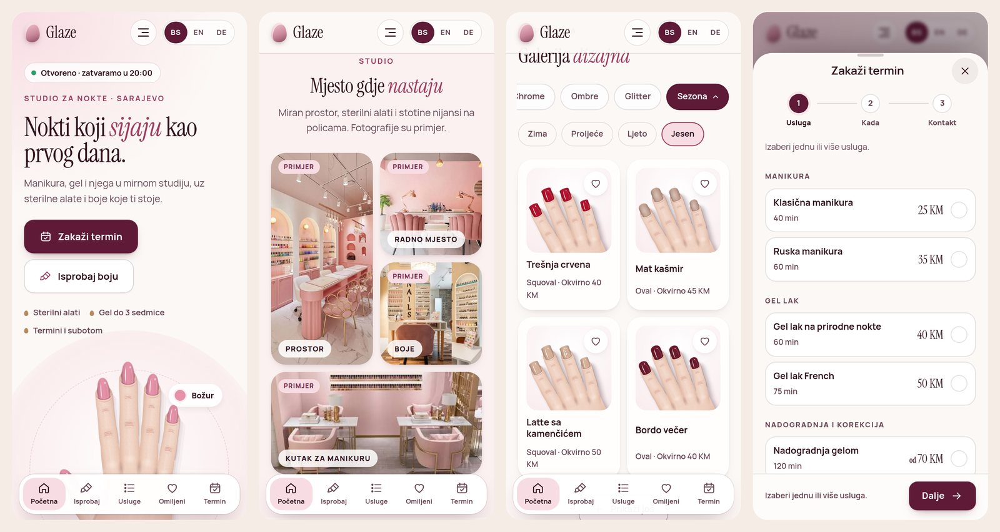

# Glaze Nail Studio

Website for a nail salon: manicure, gel polish, extensions, pedicure and care.

**Live:** https://beauty-salon.grabafaceit.workers.dev

<a href="https://beauty-salon.grabafaceit.workers.dev"></a>

<a href="https://beauty-salon.grabafaceit.workers.dev"></a>

## What's inside

- Try colours, shapes, lengths and styles on a realistic hand drawn in SVG
- A shade suggestion that matches your outfit
- Design gallery, saved favourites and the salon on Google Maps
- Booking request in one tap via Viber, WhatsApp or Instagram
- Bosnian, English and German, installable on the phone and works offline

## Tech

Plain HTML, CSS and JavaScript, no framework and no build step. Hosted on Cloudflare Workers. All salon data is in `js/salon.js`.

## Run locally

```
node serve.mjs
```

Then open http://localhost:8080.

Made by [Ahmed Grabus (Graba)](https://graba-portofolio.grabafaceit.workers.dev)
